

# CA Toolkit

**Free, offline, privacy-first tools for Chartered Accountants and finance teams.**

Built by **CA Umang Mehta**, Partner at BRS & Associates, Chartered Accountants, Jamnagar.

[**▶ Try it live**](https://imumehta.github.io/ca-toolkit/) · [Instagram @mehtaknowstech](https://www.instagram.com/mehtaknowstech/) · [All links: allmylinks.com/imumehta](https://allmylinks.com/imumehta)

   

---

## 🧰 Tools

| # | Tool | Type | What it does |
|---|------|------|--------------|
| 01 | [**PDF Suite**](01-pdf-suite/) | HTML | 15 PDF tools in one file: merge, split, protect, redact, compress, number, stamp, convert |
| 02 | [**Encrypt / Decrypt Data**](02-encrypt-decrypt-vba/) | Excel VBA | Mask client names, PANs and other text in selected cells with one click, and restore it just as easily |
| 03 | [**Ledger Lens: Bank Statement Converter**](03-bank-statement-converter/) | HTML | Bank statement PDF → Excel/CSV, with every row checked against the running balance |
| 04 | [**Section Mapper**](04-section-mapper/) | HTML | Income-tax Act 1961 ↔ 2025: find where any section went, with the official text of both side by side |
| 05 | [**Companies Act Analyser**](05-companies-act-analyser/) | HTML | Which Companies Act, 2013 provisions apply to a company, with reasons, references and compliance gaps |
| 06 | More tools | | *Coming soon* |

---

## 📄 01 · PDF Suite

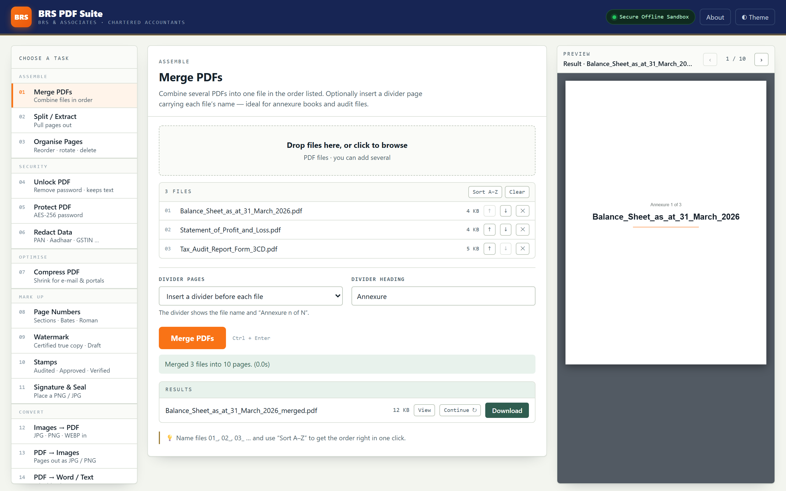

A complete PDF workbench in a **single HTML file** (about 4 MB). Every engine is embedded, so it runs entirely inside your browser:

- **No internet needed.** It works on an air-gapped office PC.
- **Nothing is uploaded.** Client files and passwords never leave your machine.
- **Nothing to install.** Double-click the file and it opens in Chrome or Edge.

### The 15 tools

| Assemble | Security | Optimise & mark up | Convert & housekeeping |
|---|---|---|---|
| **Merge PDFs**, with optional "Annexure n of N" divider pages | **Unlock PDF**, removing a known password while keeping the text | **Compress PDF** for e-mail and government portals | **Images → PDF** (JPG, PNG, WEBP) |
| **Split / Extract** by ranges or every N pages | **Protect PDF** with AES-256 plus print/copy/edit permissions | **Page Numbers**: sections, Bates, Roman | **PDF → Images** (JPG/PNG) |
| **Organise Pages**: drag to reorder, rotate, delete, duplicate, insert blanks | **Redact Data**: auto-detects PAN, Aadhaar, GSTIN, TAN, bank a/c, IFSC, mobile, e-mail and PIN | **Watermark**: "Certified true copy", "Draft" | **PDF → Word / Text** |
| | | **Stamps**: Audited, Approved, Verified · **Signature & Seal** | **Document Details**: inspect, edit or wipe metadata |

<table>
<tr>
<td width="50%">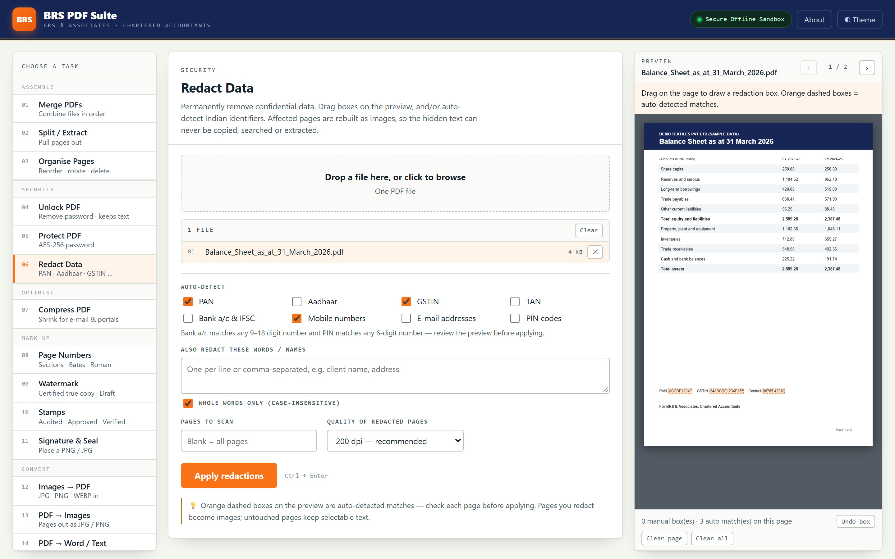 <b>True redaction.</b> Matches are found automatically, and affected pages are rebuilt as images so hidden text can't be recovered.</td>
<td width="50%">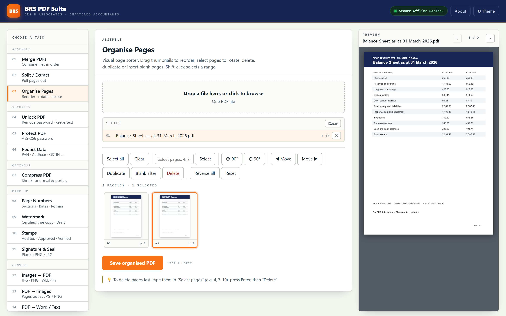 <b>Visual organiser.</b> Thumbnails, shift-click ranges, rotate and reorder.</td>
</tr>
<tr>
<td>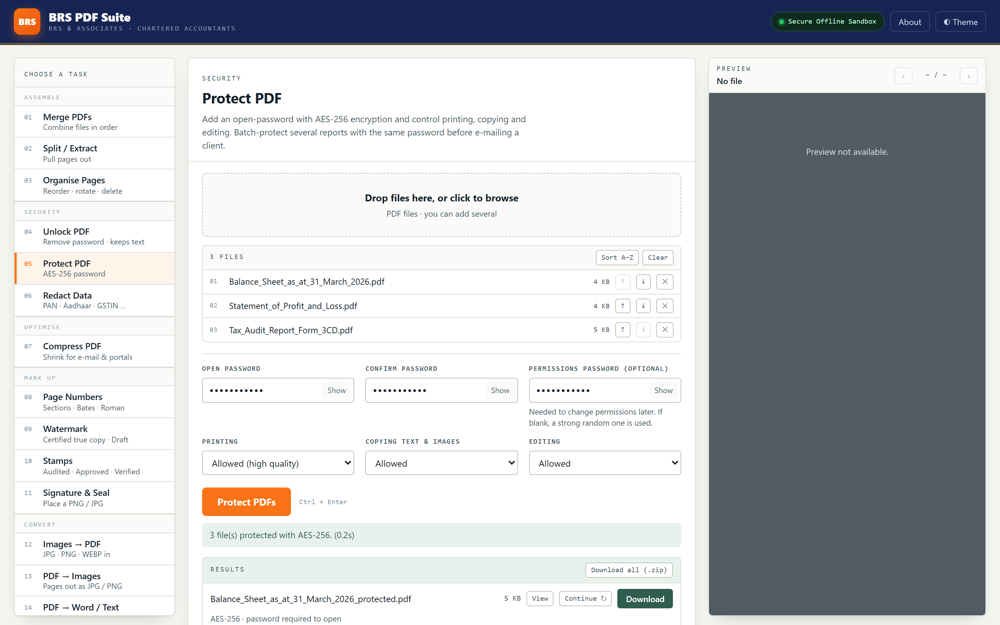 <b>Batch AES-256.</b> Protect a whole set of reports with one password before e-mailing.</td>
<td>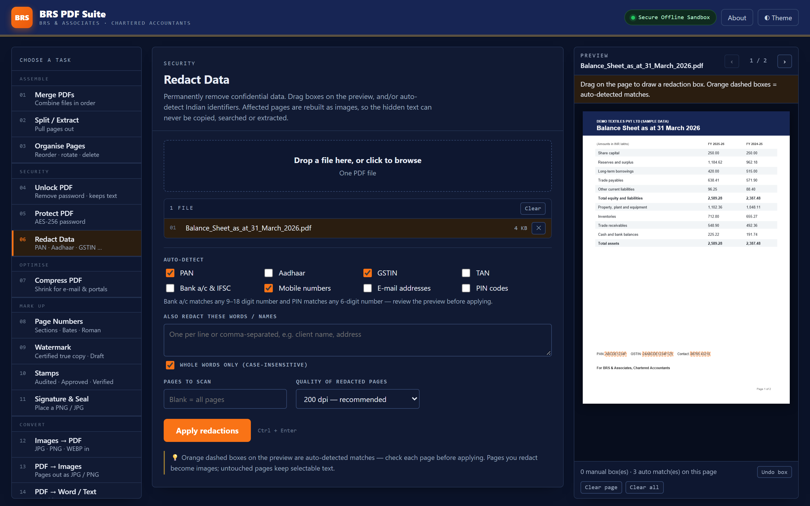 <b>Dark mode</b> for late-night filing seasons.</td>
</tr>
</table>

### How to use

**Option A: online.** Open the [live version](https://imumehta.github.io/ca-toolkit/01-pdf-suite/). It still runs 100% in your browser.

**Option B: offline (recommended for client work).**
1. Download [`01-pdf-suite/index.html`](01-pdf-suite/index.html) (on that page, use **⋯ → Download**).
2. Save it anywhere, e.g. your desktop, as `PDF_Suite.html`.
3. Double-click to open it in Chrome or Edge.

> 💡 **Tip:** Name files `01_`, `02_`, `03_` … and use **Sort A–Z** in Merge to get annexure order right in one click.

---

## 🔤 02 · Encrypt / Decrypt Data (Excel VBA)

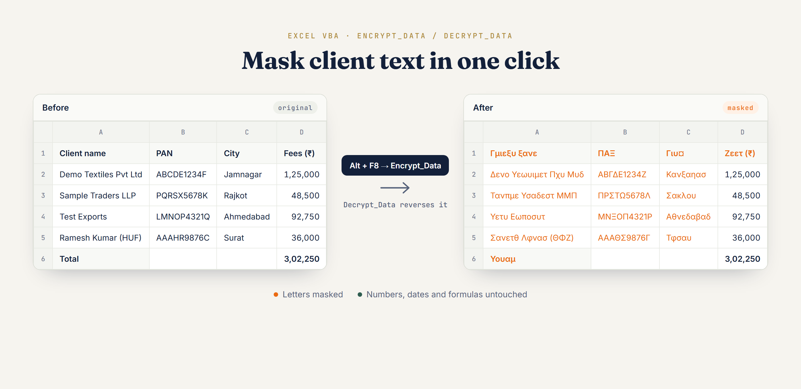

Two macros for Excel. **`Encrypt_Data`** turns every letter in the selected cells into a Greek letter or symbol (`Demo Textiles` → `Δενο Υεωυιμετ`), and **`Decrypt_Data`** turns it back. Numbers, dates and formulas are never touched, so totals keep working.

Handy for screenshots, demos and sample files where client names shouldn't be readable. It is **masking, not password security**: anyone with the macro can reverse it.

**[Install guide and download →](02-encrypt-decrypt-vba/)**

---

## 🏦 03 · Ledger Lens: Bank Statement Converter

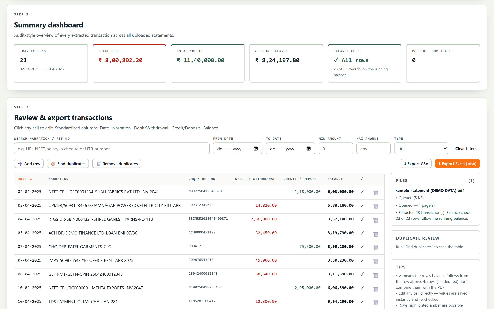

Turn bank statement PDFs into a clean Excel or CSV file (Date · Narration · Chq/Ref No · Debit · Credit · Balance) without uploading them anywhere.

- **Reads by column, not by guesswork.** It finds the statement's own headings, then places every amount under the column it sits in, so a blank Debit or Credit cell never shifts a number across. Cheque/UTR numbers and value dates stay out of the narration.
- **Checks every row.** *Previous balance + credit − debit = balance* is tested on each line. Rows that pass get ✓; anything else is shaded ⚠ so you can compare it with the PDF before you export.
- **Handles the usual layouts:** separate Withdrawal/Deposit columns, a single Amount column with Dr/Cr, `Cr`/`(Dr)` balances, overdrafts, newest-first statements, wrapped narrations, and dates printed once per day.
- **Password-protected PDFs** open with a masked password box. The password stays in the browser tab.
- **A formula-driven Excel ledger.** Title, an Opening Balance row, then Date · Narration · Ref No. · Debit · Credit · Balance, where every Balance cell is a live formula (`=F5-D6+E6`), so the workbook re-totals itself if you correct an entry. Real dates, `#,##0.00` amounts, frozen header, filters, and one sheet per statement.
- Search, date/amount filters, duplicate finder, editable cells, multi-statement merge and CSV export.
- **Works offline.** PDF reading and Excel export are built into the file. Scanned (image) statements get basic OCR, which downloads the OCR engine the first time and needs a careful review.

<table>
<tr>
<td width="50%">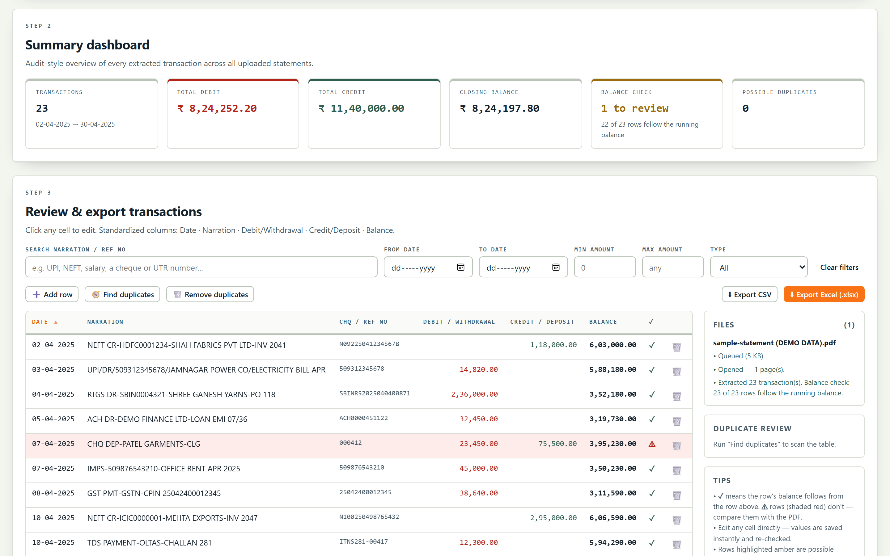 <b>The balance check at work.</b> One amount was changed by hand, so the row is flagged and the dashboard shows "1 to review".</td>
<td width="50%">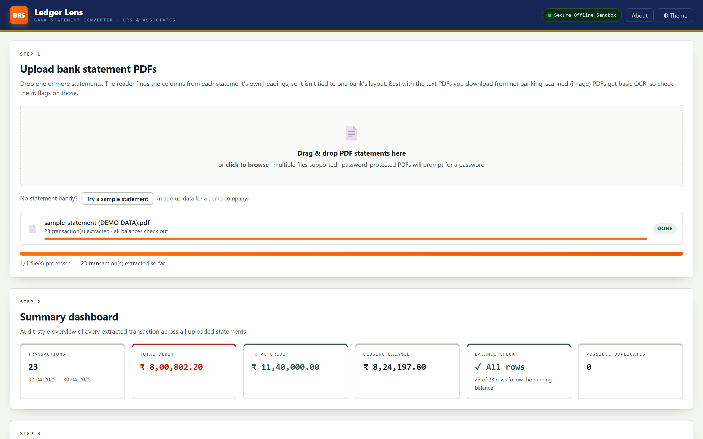 <b>No statement handy?</b> "Try a sample statement" loads a made-up one-page statement.</td>
</tr>
</table>

**[▶ Open Ledger Lens](https://imumehta.github.io/ca-toolkit/03-bank-statement-converter/)** · or right-click → *Save link as…* on [the HTML file](03-bank-statement-converter/index.html) to keep it on your desktop. A [sample statement](03-bank-statement-converter/sample-statement.pdf) (made-up data) is included.

> Always glance at the ⚠ rows and the totals against the PDF before relying on the output. Every bank formats statements differently. If one isn't read well, email **CA Umang Mehta** at [umang.mehta@mail.ca.in](mailto:umang.mehta@mail.ca.in) or [open an issue](../../issues), with account numbers and names masked.

---

## ⚖️ 04 · Section Mapper: Income-tax Act 1961 ↔ 2025

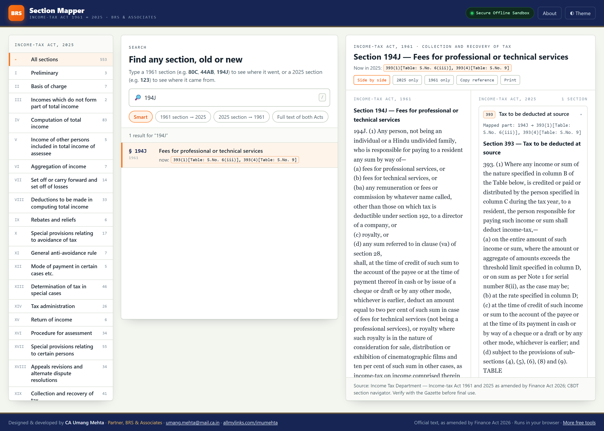

The Income-tax Act, 2025 replaced the 1961 Act from 1 April 2026, and every familiar section number changed. Section Mapper answers "where did it go?" in one search.

- **Both directions.** Type a 1961 section (`80C`, `44AB`, `194J`) to see its 2025 home, or a 2025 section (`123`) to see where it came from, down to the sub-section or Schedule table entry (e.g. `194J → 393(1) [Table: S.No. 6(iii)]`).
- **Official text of both Acts, side by side**, as published by the Income Tax Department, as amended by **Finance Act 2026**, with amendment footnotes. Rate tables (TDS, TCS, Schedules) display as tables.
- **Nothing hidden.** 1961 sections that were omitted or made redundant are flagged, and 2025 sections changed by Finance Act 2026 are marked, including ones that were substituted after the mapping was published (e.g. s.446).
- Full-text search across both Acts, chapter browser, copy reference, print, dark mode. One HTML file that works offline.

<table>
<tr>
<td width="50%">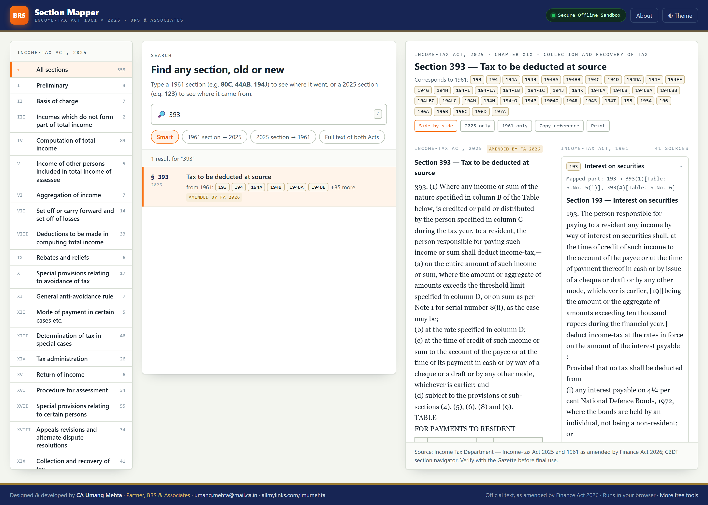 <b>One new section, 41 old ones.</b> s.393 with its TDS rate table and every 1961 source.</td>
<td width="50%">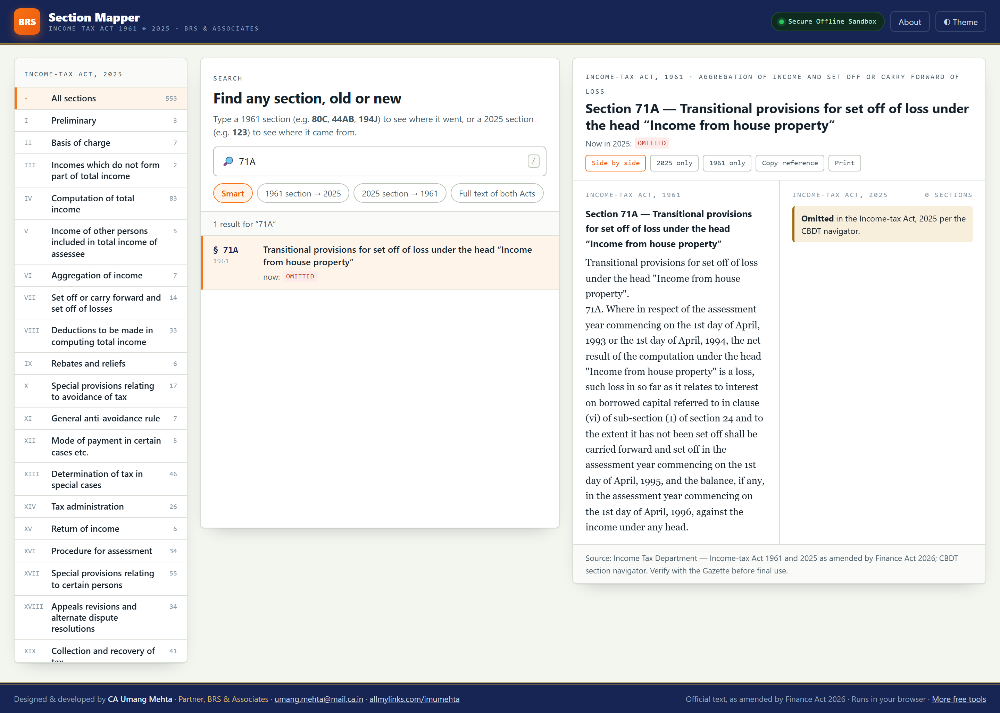 <b>Omitted and redundant sections</b> are flagged, as per the CBDT navigator.</td>
</tr>
</table>

**[▶ Open Section Mapper](https://imumehta.github.io/ca-toolkit/04-section-mapper/)** · or save [the HTML file](04-section-mapper/index.html) to use offline.

> **Sources:** text of both Acts from the Income Tax Department's website (incometaxindia.gov.in), as amended by Finance Act 2026; section mapping from the CBDT section navigator (1961 → 2025). This is a reference aid, not legal advice. Verify with the Gazette text, CBDT notifications and later amendments before relying on it. Spotted an error? Email [umang.mehta@mail.ca.in](mailto:umang.mehta@mail.ca.in).

---

## 🏛️ 05 · Companies Act Analyser

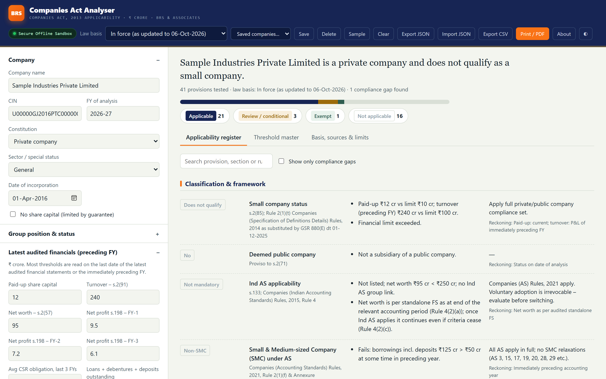

Does this company need independent directors? A whole-time CS? Internal audit, secretarial audit, CSR, cost audit, XBRL? The answers turn on paid-up capital, turnover, borrowings and constitution, each read on a different date. Companies Act Analyser tests them all in one go.

- **41 provisions tested** across classification (small company, deemed public, Ind AS, SMC, NFRA), board, committees and CSR, KMP, audit and auditor reporting (rotation, internal and secretarial audit, cost audit, CARO, IFC), filings and returns, and capital, loans and deposits.
- **Every result shows its reason**: the reference, the figures that triggered it, what to do, and the date the test is read on.
- **Compliance gaps.** Enter directors, IDs, women directors and KMP in position, and it flags what's missing, with the time limit to fill it.
- **Current law**, as updated to 06-Oct-2026, including the ₹10 cr / ₹100 cr small-company limits (GSR 880(E), 01-12-2025). A **threshold master** lists every limit with its authority; switch to custom thresholds when a new notification lands. A separate mode shows the effect of the Corporate Laws (Amendment) Bill, 2026, which is *not* law yet.
- Save companies in your browser, export JSON or CSV, print a working paper with prepared-by / reviewed-by boxes. One HTML file that works offline.

<table>
<tr>
<td width="50%">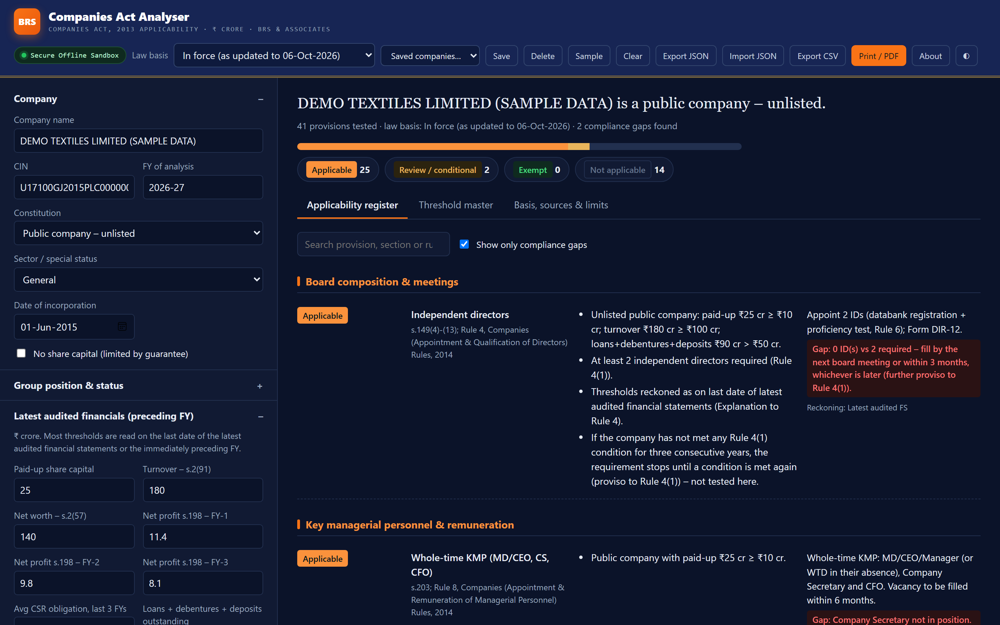 <b>Compliance gaps</b> with the rule and deadline.</td>
<td width="50%">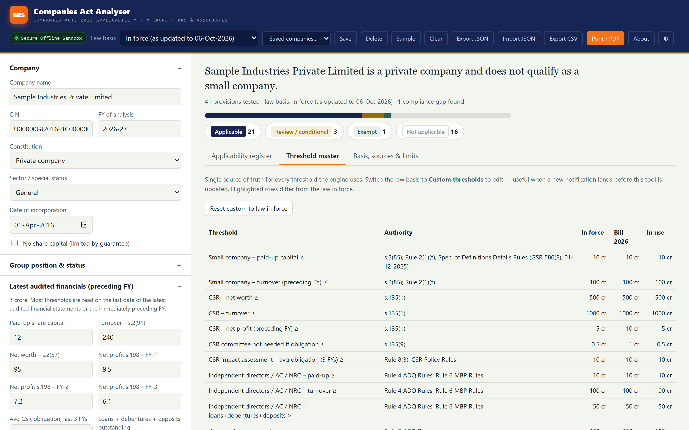 <b>Threshold master:</b> every limit and its authority.</td>
</tr>
</table>

**[▶ Open Companies Act Analyser](https://imumehta.github.io/ca-toolkit/05-companies-act-analyser/)** · or save [the HTML file](05-companies-act-analyser/index.html) to use offline.

> A working-paper aid, not legal advice. Interpretation points (deemed public status, CSR for Section 8 companies, reach of the filing-default condition) are flagged, not decided. Validate high-stakes conclusions against the bare Act, Rules and notifications on the MCA portal. Spotted an error? Email [umang.mehta@mail.ca.in](mailto:umang.mehta@mail.ca.in).

---

## 🔒 Privacy

- No servers, analytics, cookies or uploads. The HTML tools run in your browser tab and the macros run inside your own Excel. (The bank statement converter contacts a CDN only if you open a *scanned* statement, to fetch the OCR engine; your file is not sent.)
- The only thing the HTML tools store locally is your light/dark theme preference.
- Only process documents you are authorised to handle.

## 🏗️ Built with

These open-source engines are embedded in the HTML files:

| Engine | Purpose | License |
|---|---|---|
| [pdf-lib](https://github.com/Hopding/pdf-lib) 1.17.1 | Creating and editing PDFs | MIT |
| [PDF.js](https://github.com/mozilla/pdf.js) 3.11.174 | Rendering pages and extracting text | Apache-2.0 |
| [JSZip](https://github.com/Stuk/jszip) 3.10.1 | "Download all" as .zip | MIT / GPLv3 (used under MIT) |
| [qpdf](https://github.com/qpdf/qpdf) 11 (WebAssembly) | AES-256 encryption and decryption | Apache-2.0 |
| [Tesseract.js](https://github.com/naptha/tesseract.js) 5.0.4 | OCR for scanned statements (loaded on demand, not embedded) | Apache-2.0 |

See [THIRD_PARTY_NOTICES.md](THIRD_PARTY_NOTICES.md).

## 🤝 Feedback

Found a bug or have an idea for a tool that would save CAs time? [Open an issue](../../issues) or DM [@mehtaknowstech](https://www.instagram.com/mehtaknowstech/) on Instagram.

## 📜 License

[MIT](LICENSE) © 2026 Umang Mehta. Free to use, share and adapt, with attribution.
